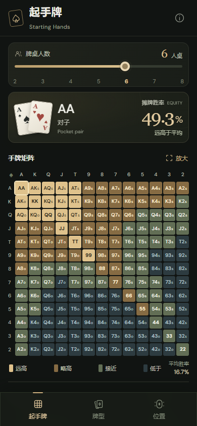
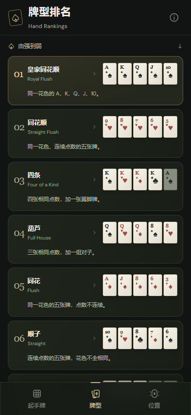
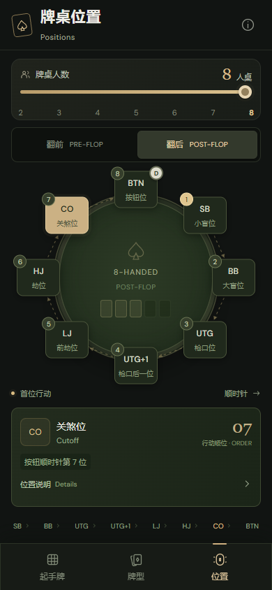

# Texas Poker Assistant

[打开网站 ↗](https://jerryliruijie.github.io/texaspokerassistant/)

- **起手牌**：2–8 人桌胜率矩阵、发牌概率。
- **牌型**：强度排名、成牌图示、比较规则。
- **位置**：座位名称、翻前与翻后行动顺序。

<p>
  
  
  
</p>

## 开发

Node.js 22.12+ · React · TypeScript · Vite

```sh
npm ci
npm run dev
```

```sh
npm test
npm run build
```

推送到 `main` 后，[自动部署](https://github.com/jerryliruijie/texaspokerassistant/actions/workflows/deploy.yml)至 GitHub Pages。
